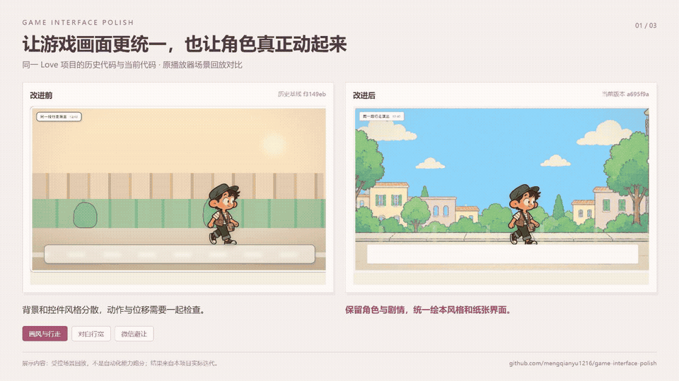
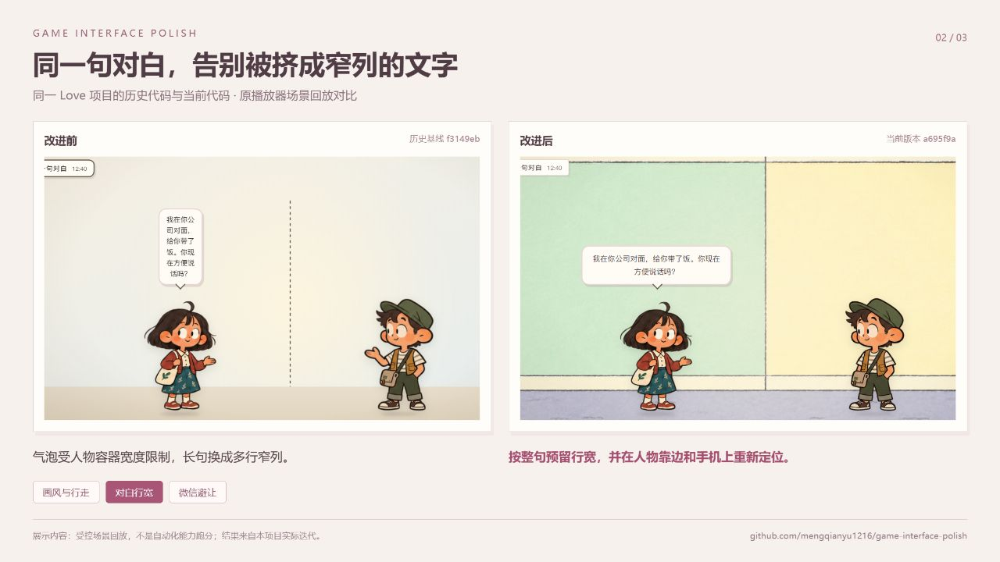
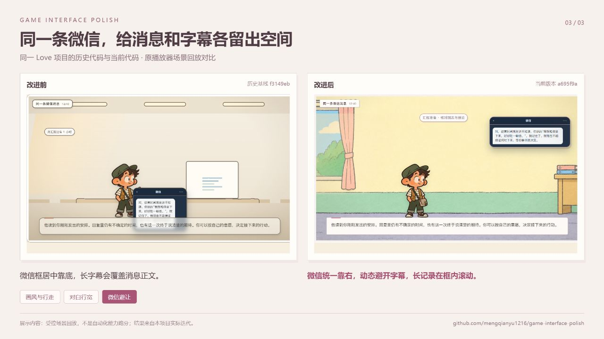

# Game Interface Polish

**把已有游戏打磨成风格统一、文字可读、交互可用的作品。**

面向 Codex 的游戏界面迭代 Skill，来自《惊喜》双视角叙事游戏的真实迭代：保留已有剧情与角色资源，处理场景画风、人物动作、字框排版、消息遮挡、手机适配与可运行交接包。



[观看 24 秒对比视频](assets/before-after-demo.mp4) · [下载 Skill 安装包](https://github.com/mengqianyu1216/game-interface-polish/releases/latest) · [查看 Skill 主入口](skills/game-interface-polish/SKILL.md)

## 从游戏的变化，看工作流的作用

| 问题 | 改进前 | 改进后 | 对应方法 |
| --- | --- | --- | --- |
| 画风与演出 | 背景和控件风格分散 | 保留角色动作，统一绘本场景与纸张控件 | 素材分层、状态与动画一起检查 |
| 对白行宽 | 气泡被人物容器挤成窄列 | 按完整台词预留空间，图片加载与尺寸变化后重排 | 测量实际容器、处理异步布局 |
| 微信与字幕 | 微信居中靠底，长字幕压住正文 | 微信统一靠右，动态预留字幕空间，历史消息可滚动 | 浮层职责、几何避让与双端验收 |

### 同一句对白



### 同一条微信



这些画面来自同一项目的历史代码和当前代码，使用原播放器回放相同场景、台词和消息。视频包含真实浏览器画面采样与片段剪辑；它展示本项目的迭代结果，不构成不同工具的能力跑分或“一次提示就能完成”的保证。[查看素材来源与验证范围](docs/evidence.md)。

## 安装

使用 [Skills CLI](https://github.com/vercel-labs/skills)：

```bash
npx skills add mengqianyu1216/game-interface-polish --skill game-interface-polish -a codex
```

或者从 [Releases](https://github.com/mengqianyu1216/game-interface-polish/releases/latest) 下载 ZIP，将 `game-interface-polish` 文件夹放到自己的 Codex `skills` 目录。已有同名版本时先备份再替换，避免重复安装同范围的 Skill。

## 怎么用

在 Codex 中输入：

```text
使用 $game-interface-polish 完善这个游戏。
沿用已有角色、完整剧情和动画，只参考附件里的纸张风格优化边框。
首页主按钮保持原文，通过案例卡片进入游戏。
修复气泡过窄、微信与字幕遮挡，并检查电脑和手机。
完成后给我可独立运行的源码包和真实效果图。
```

也可以只提出一个局部任务，例如“把微信框移到右侧，长消息不要被字幕挡住”。Skill 会按改动范围读取相关参考，不要求每次重做全部流程。

## 包含哪些能力

- **版本融合**：选定当前基线，吸收新版中有用的素材与分支，保留确认过的行为。
- **素材与画风**：区分舞台内背景、纸框、整页外侧底图和交互浮层，参考风格不会自动改动产品入口。
- **角色与演出**：校准图集、脚底、朝向和道具；检查动作、位移、暂停、倍速与跳过。
- **消息与排版**：处理气泡收缩、异步图片布局、长消息滚动、字幕避让与透明选择面板。
- **网页 / Godot 衔接**：明确剧情权威状态、渲染职责、坐标转换与异步切章回调。
- **验证与交付**：真实浏览器查看、关键操作、文件清单、干净目录解压启动与隐私检查。
- **视频按需衔接**：需要视频时再读取 Remotion / Hyperframes 的相关指导，不给普通界面修复增加无关运行依赖。

## 文件结构

```text
skills/game-interface-polish/
├── SKILL.md
├── agents/openai.yaml
└── references/
    ├── art-direction.md
    ├── game-scenes.md
    ├── ui-overlays.md
    ├── version-merge.md
    ├── verification-delivery.md
    ├── video-bridge.md
    └── sources.md
```

浏览器、图像生成工具、Godot 和视频框架按项目需要检查；本仓库提供工作流与参考，不捆绑运行环境和完整游戏工程。

## 来源与素材

融合了本项目的实际迭代经验、用户提供的游戏迭代 Skill，以及 [Remotion Agent Skills](https://github.com/remotion-dev/skills) 和 [Hyperframes](https://github.com/heygen-com/hyperframes) 中适用的视频生产方法。上游工具与指导保持独立，详见 [来源说明](skills/game-interface-polish/references/sources.md)。

案例画面中的角色与插画归各自权利人所有，用于说明游戏改进效果。本仓库未附可复用的游戏美术资源包；参考链接不改变上游素材或工具的授权条款。
